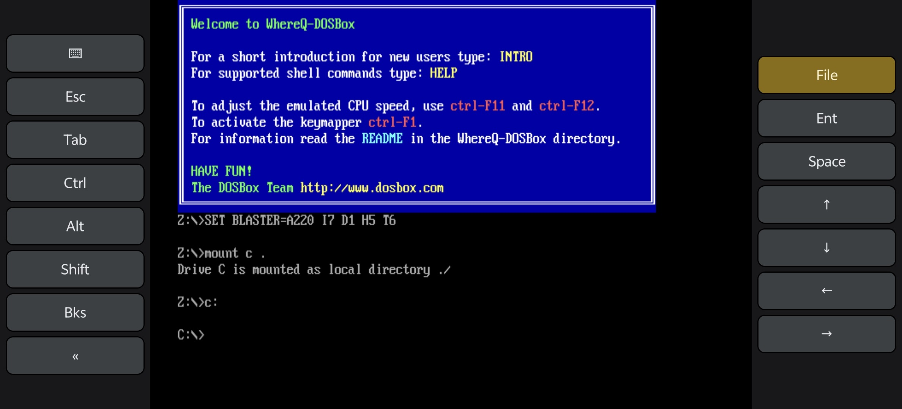

<p align="center">
  <picture>
    <source media="(prefers-color-scheme: dark)" srcset="resources/whereq-dosbox-logo-transparent.png">
    
  </picture>
</p>

<h1 align="center">WhereQ-DOSBox</h1>

<p align="center">
  A native <b>Android</b> port of DOSBox — the emulator core runs as
  <code>libdosbox.so</code> inside an APK, not in a browser.
</p>

<p align="center">
  
</p>

<p align="center">
  <sub>The DOSBox welcome screen, a mounted drive and the two-pad on-screen
  keyboard — the picture in the middle, one hand on each side, touch moves the
  DOS mouse, the keys type into DOSBox.</sub>
</p>

---

It runs DOS games. Install a `.zip` bundle, press **Play**, and the emulator
boots into it; a running game can be frozen into a **save state** — the whole
machine, the sound chips included — and resumed later, even after the app was
killed. The on-screen keyboard and the touch input are part of the app, not
add-ons.

The Android migration is complete: the emulator core, the app layer, the
bundle launcher, the save states and the build pipeline are all in place and
verified. What follows is maintenance — bug fixes and documentation.

**New to the app? Start with the
[user guide](docs/USER-GUIDE.md)** — it walks through installing the app,
installing a game, playing it, saving a state and keeping your saves safe, one
step at a time, with a screenshot of every screen. No DOS knowledge needed.

New in 1.0.0.17
---------------

A **maintenance** release: two things in **Game Mode** that only the screen
could show, and the **privacy policy**, which now lives in this repository.

| | |
|---|---|
| **The FIRE button shows that it can be remapped** | While the remap mode is on, the buttons you can remap get an outline. The FIRE button is filled with the same gold as the outline, so the outline was **invisible** and the button looked like any other one. The outline now follows the button it marks: gold on the dark buttons, dark brown on the gold one. |
| **The D-pad button names the mode you actually have** | The button in the bottom row of the left pad cycles the D-pad output between **ARROWS**, **NUMPAD** and **WASD**, and it carries the name of the current mode. When the app remembered a different mode for that game, the button could say *ARROWS* while the D-pad was sending *WASD*. It follows the mode now. |
| **The privacy policy is in the repository** | The app collects no data and does not ask for the `INTERNET` permission, so it cannot send anything anywhere even if it wanted to. The policy says so in full, and now lives in [`docs/PRIVACY.md`](docs/PRIVACY.md) — next to `COPYING` and `NOTICE`, where its whole history is public. The launcher's footer opens it, next to the link to the licence screen. |

The emulator core, the bundle launcher, the keyboard and the save states are
unchanged — **every save state written by the earlier releases loads
normally**.

New in 1.0.0.16
---------------

A **maintenance** release: the phone's **Back button works again**, the app
runs on the devices that need **16 KB memory pages**, and the **licence
travels with the app**.

| | |
|---|---|
| **The Back button works again** | From Android 13 on, the system stopped sending the back key to the app — and SDL's surface swallowed what did arrive, so the Back button did **nothing at all**. The app now handles the back gesture itself, the way Android expects it to. |
| **The presses walk out in order** | Back closes the launcher, then leaves **Game Mode**, then folds the keyboard panel, and only then leaves the app. Before, the first press folded the hidden panel and left Game Mode standing. |
| **16 KB memory pages** | The native library is now aligned for 16 KB pages, so it loads on the 64-bit devices that require it (Android 15 and newer). Every loadable segment of `libdosbox.so` is checked in CI now. |
| **The DRAG lock no longer holds the mouse** | Leaving Game Mode while the **DRAG** button was locked used to leave the left mouse button **down** inside DOSBox — a game saw a click that never ended. The lock is released together with the keys and the other buttons. |
| **The licence travels with the app** | The app is GPLv2, so the licence and the copyright notices have to travel with the program: the full **GPL v2** text and the **NOTICE** are in the APK, and the launcher's footer links to them, next to the link to the complete source. |

The decision about what a back press does now lives in one tested place, and
the back button is covered by a test that presses the real button on a real
device.

New in 1.0.0.15
---------------

A release with a **feature**: **Game Mode**, a console-style gamepad for the
action games that want one — a direction pad, a trackball and the buttons a
DOS game fires, jumps and strafes with.

| | |
|---|---|
| **Game Mode** | With the keyboard pads showing, switch **Caps Lock** on (double-tap **Shift**) and type the Konami code — **↑ ↑ ↓ ↓ ← → ← → B A** — and the pads flip into a gamepad: an eight-way D-pad, a trackball, and Y, X, CTRL, ALT, SPACE and ENT. The same code on the D-pad (then **X, Y**) takes you back, and the phone's Back button does it too. |
| **The B and A must be capital** | The code is matched on the case the letters are actually typed in, so a lowercase *"ba"* just types *"ba"* into the DOS prompt. |
| **Every button can be remapped** | Long-press the gold profile button and pick **Remap buttons…**. The remap belongs to that one game and is remembered, so the same title always plays the same way. |
| **The gamepad is a keyboard** | The gamepad sends the same SDL events the on-screen keyboard sends, so the guest cannot tell the two apart — there is no new input path to teach a game. The trackball sends the relative mouse events the SDL layer now accepts. |
| **Leaving the app is clean** | A shutdown that failed used to abort the process with SIGABRT while it was only shutting down. The error is caught now and the exit carries on. |
| **The save-state format did not change** | The Game Mode is a new way to press the same keys, so every save state written by the earlier releases loads normally. |

The documentation gained a chapter on the gamepad and a case study of a finger
that becomes a DOS keystroke, and every box-drawing diagram in the docs is
now an SVG with straight borders.

New in 1.0.0.14
---------------

A **patch** release with three save-state repairs: the requests no longer
answer each other, a duplicated handle survives a restore, and a restore no
longer leaks a file descriptor.

| | |
|---|---|
| **A save that times out no longer answers the next request** | A save or a restore that overran its time limit used to hand its late result to the *next* request — the new request was answered with an old answer, and the file on disk could be the file the old request wrote. Every request now carries a generation, and a completion that arrives after its request gave up is dropped. |
| **A duplicated handle survives a restore** | A handle duplicated with INT 21h/45h is two names for one file, and the restore keeps that sharing: the reference count goes back as it was saved, so closing one of the two names no longer takes the other down with it — which used to end in *"invalid handle"*. |
| **A restore no longer leaks a file descriptor** | The machine a restore replaces is closed properly now, whatever its reference count. Before, a state in which a handle was shared left one host file descriptor open per restore, for the rest of the session. |
| **The save-state format did not change** | All three fixes are in the snapshot's plumbing, not in the file, so every save state written by the earlier releases loads normally. |

New in 1.0.0.13
---------------

A **patch** release: the name and the mark of the project are on the app again,
and a restored save keeps the time it was made.

| | |
|---|---|
| **The app is WhereQ-DOSBox** | The launcher name, the notification and the launcher icons carry the name and the mark of the project, the package is `com.whereq.dosbox` and the download is `whereq-dosbox-1.0.0.13.apk` — so the app installs under its own id and updates in place from the earlier releases. |
| **A restored save keeps the time it was made** | Loading a save state rewrites the local file, and the launcher read the time off that file — so every restored slot claimed to be *"just now"*. The original save time is carried over now: a slot made five hours ago still says *five hours ago* after it has been restored. |
| **The save-state format did not change** | The fix is in the launcher, not in the snapshot, so every save state written by the earlier releases loads normally. |

New in 1.0.0.12
---------------

A **patch** release on top of the `android-migration-complete` milestone. The
mouse work that closed the migration phase is what 1.0.0.11 shipped; this
release repairs the packaging around it and moves the saves out of the app's
own storage.

| | |
|---|---|
| **Your saves survive a reinstall** | The save-state slots lived inside the app's private storage, so uninstalling the app deleted them. Pick a folder on the phone (**Config → Saves folder**) and every slot is mirrored there, gzipped, next to the game itself — so a reinstall, a new phone or a lost app all come back. Two archives with the same file name are told apart by name (*game* and *game (2)*), so their saves never end up in the same place. |
| **The save state keeps the mouse driver's configuration, not its run-time state** | 1.0.0.11 put the *whole* INT 33h driver into the snapshot, event queue and interrupt flags included. Restoring that wedged mouse-driven games — a game could hang on load. The snapshot now carries only the configuration the guest cannot rebuild itself: the game's event-callback registration, the cursor range and position, the cursor shape and hotspot, the granularity and the sensitivity. The visible cursor therefore still lines up with the click point after a restore. |
| **The emulator knows its own version** | The version was a literal `1.0.0.1` in the Android config template, so the DOS banner and the window title said *WhereQ-DOSBox version 1.0.0.1* whatever release was installed. The native build now reads the same `VERSION` file the release script and the app read, so the two can never disagree. |
| **A local build ships all three ABIs** | `android/build-android.sh` and `android/build-sdl2.sh` defaulted to two of them, so an APK built locally did not carry the same ABI set as the published one. Both now build `arm64-v8a`, `armeabi-v7a` and `x86_64` by default — the same set CI builds. |

**Save states written by 1.0.0.11 and by the earlier 1.0.0.12 cuts cannot be
loaded by this build**: the state file grew a version when the mouse block
changed, and an older state is refused rather than misread.

**This release was re-cut.** The tag still reads `v1.0.0.12`, but the file
behind the download link is a different build than the one first published
under that name, so its checksum is a different one too. The release page
carries the current checksum.

New in 1.0.0.11
---------------

| | |
|---|---|
| **The mouse has a right button** | A DOS mouse has two buttons and a touchscreen has one, so there was no way to send a right click — and in most DOS games the right button is *cancel* or *back*. The on-screen keyboard now has an **RMB** key on the left pad, next to **Tab**, and a **second finger** on the picture does the same at that finger's own position. |
| **A click is a held button, not a tap** | The first finger holds the **left** button for as long as it is down, so a drag still drags, and the right button is held the same way. This is what a game that reads the mouse *live* needs — the button state at INT 33h AX=3. A click that was over in a millisecond could fall between two polls and be missed altogether. |
| **The mouse survives a save state** | The INT 33h driver keeps its state outside the guest's memory — the game's event-callback registration, the cursor range and the button state. It was not in the snapshot, so after a restore the cursor still moved but the game's clicks stopped reaching it: a dialog's *confirm* button did nothing. The driver is now part of the state. |

**Save states written by 1.0.0.10 cannot be loaded by this build**: the state
file grew a version when the mouse driver joined the snapshot, and an older
state is refused rather than misread.

New in 1.0.0.10
---------------

| | |
|---|---|
| **The sound survives a save state** | The FM chip is now snapshotted **exactly** — the envelope, the wave phase and the LFO counter all come back with the state. In 1.0.0.9 the chip was not in the snapshot at all: the music kept playing while the rest of the machine was rewound, and it was gone entirely when a state was restored into a fresh process. Now the sound comes back with the machine, in the middle of the note rather than at the beginning of it. The PC speaker comes back silent instead of droning on its own. |
| **A key no longer sticks** | Rotating the phone while a key was held left that key pressed in DOSBox for ever. Every key that is down is now released when the layout is rebuilt, and a modifier that is shown in two places (the pad and the fold-up panel) counts its fingers instead of assuming there is only one. |
| **The launcher fits on the screen** | The **Files** panel measures the space it has and caps the game list to it, so a third game no longer pushes its buttons off the bottom edge where nothing could bring them back. |
| **The desktop build links again** | The save-state code was missing from the autotools build and the two archives had a circular dependency — the desktop baseline compiles and links again, which is what keeps the emulator core honest. |
| **A technical reference** | [`docs/TECHNICAL-REFERENCE.md`](docs/TECHNICAL-REFERENCE.md) — the whole implementation in one document, with the diagrams: the native build, the save-state machine, the exact FM snapshot, the bundle launcher, the on-screen keyboard, the throughput benchmark, what is still open and the screenshot gallery. |

The emulator core changed in this release — the sound chips are part of the
snapshot now. **Save states written by 1.0.0.9 cannot be loaded by this
build**: the state file grew a version, and an older state is refused rather
than misread.

New in 1.0.0.9
--------------

| | |
|---|---|
| **The keyboard is a console now** | In landscape the keys sit in the two black bars beside the picture, the way a handheld console is built: the **left pad** holds the arrow keys as a D-pad and the left half of a split QWERTY, the **right pad** holds the action keys (Alt, Ctrl, Shift, Space, Enter) and the right half. Nothing covers the picture any more. |
| **Three layers, one key each** | **#+=** swaps both halves for the punctuation, **Fn** for F1–F12, Ins/Del, Home/End, PgUp/PgDn, Caps, PrtSc and Pause. The switched key lights up while its layer is on. The letter layer already carries `: . / \`, so a DOS path needs no switching at all. |
| **Modifiers work both ways** | *Tap* Ctrl, Alt or Shift and it stays armed for the next key (Ctrl, then C). *Hold* it and it behaves like a real key for as long as the finger is down — which is what a game expects from its fire and strafe keys while the other thumb steers. |
| **The layout follows the screen** | A bar wide enough (≥ 116 dp) gets the full pads; a narrower one gets a single key column per side and the fold-up QWERTY; portrait gets a slim strip along the bottom. The letter keys are about 33 dp wide on a 20:9 screen and about 24 dp on an 18:9 one. |

The whole change is in the app layer — the emulator core is the one from
1.0.0.8, unchanged.

New in 1.0.0.8
--------------

| | |
|---|---|
| **Save states** | Every game gets three slots. **Save** freezes the whole running machine — the CPU, the DOS memory, the video memory, the open DOS file handles, the hardware timers — and **Load** jumps back to that exact moment. A slot is a file on the phone, so it survives quitting the app and rebooting the phone. |
| **Resume resumes** | The **Resume** button used to start the last game from the beginning. It now restores its newest save state, so the player continues where they left off. With no save state the game starts from the beginning, as before. |
| **The arrows** | In landscape the four arrow keys sit in the inverted T of a real keyboard — up on top, left and right side by side, down below — in the right-hand column next to **File**, **Ent** and **Space**. |
| **The game keeps running** | While a game is running, a small ongoing notification holds the emulator process, so switching to another app no longer loses the game. Tap the notification to come back to the same frame. |

The upstream project this is based on is [Em-DOSBox][em-dosbox], the
Emscripten/web build of DOSBox r4305 by [Boris Gjenero][dreamlayers]. The
DOSBox core here comes from that tree and keeps its GPLv2 license, its
`AUTHORS`, its `ChangeLog` and its per-file headers.

The port touches the core in a handful of places, all of them small and local:

| Where | What |
|---|---|
| `src/gui/sdlmain.cpp` | the Android display, touch and on-screen keyboard paths, fenced behind `#if defined(__ANDROID__)` |
| `include/mouse.h`, `src/ints/mouse.cpp` | the touch-to-DOS-mouse mapping, likewise fenced |
| `src/gui/savestate.cpp`, `src/dos/dos_state.cpp` | the save-state machine: the snapshot of the machine, and the DOS layer inside it (new files) |
| `src/hardware/adlib.cpp`, `src/hardware/dbopl.cpp`, `src/hardware/pcspeaker.cpp` | the sound chips: the exact FM chip snapshot, and the PC speaker reset on a load |
| `src/hardware/pic.cpp`, `src/hardware/timer.cpp` | the interrupt controllers and the PIT, so their phase is part of the snapshot |
| `src/hardware/vga_dac.cpp`, `src/hardware/vga_draw.cpp`, `src/cpu/core_dynrec.cpp` | the state that is *rebuilt* after a restore instead of restored |
| `src/Makefile.am`, `src/dos/Makefile.am`, `src/gui/Makefile.am`, `include/Makefile.am` | the build files, so the desktop baseline stays in sync with the Android one |
| the product name | the upstream product name → **WhereQ-DOSBox** in the banner, the version string, the config and the generated headers |

Everything else in `src/` and `include/` is the imported upstream code. The
technical reference lists every change with the reason for it.

Status
------

Verified on an emulator (API 37, x86_64): DOSBox reaches the `C:\>` prompt,
the picture is rendered through the SDL2 texture path with aspect-correct
letterboxing, touch moves the DOS mouse to the computed cell, and the
on-screen keyboard types into DOSBox with no upstream patch
(`SDL_PushEvent` → mapper → `KEYBOARD_AddKey`).

The bundle launcher was verified with the same emulator: a bundle was picked
with the system file picker, unpacked, started with **Play**, and both
`F1赛车1994` (F1 Formula One Championship) and `创世纪8` (Ultima VIII) ran
in the emulator.

The CPU core is set to `core=auto`: a program that stays in real mode runs on
the interpreter, and a program that switches into protected mode hands over to
the recompiling (JIT) core, which is compiled into `libdosbox.so` for all three
ABIs. Both paths were verified on the emulator — STARFALL in real mode, Ultima
VIII in protected mode. `core=normal` in `dosbox.conf` is the fallback if the
JIT code cache cannot be allocated.

**Save states** were verified the same way: a game was frozen into a slot
while it was running, the app was killed, and **Resume** brought the game back
exactly where it was — the restored machine matches the saved one down to the
CPU registers, and the game keeps playing. See [Save states and
Resume](#save-states-and-resume) below.

The **sound chips** were verified the same way, with a test program that
programs one sustained tone on the FM chip and then waits for a key
([`examples/opl-test-bundle`](examples/opl-test-bundle)). The port writes one
line to the log on every save and on every load, and the two lines have to be
identical — same envelope, same wave phase, same LFO counter. They are,
two minutes of live chip time apart.

| | |
|---|---|
| Emulator core | DOSBox r4305 (SDL2 branch) |
| Android target | `arm64-v8a`, `armeabi-v7a`, `x86_64`, minSdk 21 |
| Toolchain | NDK r27 + CMake; also builds a plain desktop Linux baseline |
| Version scheme | `v{major}.{minor}.{patch}.{build}` — see `bin/release.sh` |
| APK size | ~15.7 MB with all three ABIs (the native libraries are stored uncompressed, so they can be mapped straight from the APK) |

The on-screen keyboard
-----------------------

The DOS picture is 4:3 and centred, so a phone in landscape has a black bar on
either side of it. The keys live in those bars, laid out like a handheld
console: the picture in the middle, one hand on each side, nothing on top of
the picture.

* **The left pad** — the arrow keys as a D-pad under the left thumb (up on
  top, left and right side by side, down below); above it the left half of a
  split QWERTY, and **File**, **Esc**, **Tab** and **RMB** along the top.
* **The right pad** — the action keys under the right thumb: **Alt**,
  **Ctrl**, **Shift**, **Space** and **Enter**; above them the right half of
  the QWERTY, and **#+=**, **Fn** and Backspace along the top.
* **The split QWERTY** has a number row and carries `: . / \` on the letter
  layer, so a DOS path needs no switching. **#+=** swaps both halves for the
  punctuation, **Fn** for F1–F12, Ins/Del, Home/End, PgUp/PgDn, Caps, PrtSc
  and Pause.

Ctrl, Alt and Shift work both ways: *tap* one and it stays pressed for the next
key (Ctrl, then C), or *hold* it like a real key while the other thumb steers —
which is what a game expects from its fire and strafe keys.

The DOS mouse has two buttons and a touchscreen has one. **RMB** sends a right
click where the DOS cursor stands, and a second finger on the picture does the
same at that finger's own position. Both are *held* while the finger is down
rather than tapped, because a game that reads the mouse live — the button
state at INT 33h AX=3 — misses an instantaneous click. The first finger holds
the **left** button for as long as it is down, so a drag still drags.

On a 16:9 screen the bars are too narrow for half a keyboard, so each side is
a single column — the arrows left, the action keys right, with **RMB** above
the arrows — and the full QWERTY folds up from the bottom with **⌨**. In
portrait the keys are a slim strip along the bottom, with the same fold-up
QWERTY and an **RMB** key of its own.

The pads are tight on an 18:9 screen: the letter keys come to about 24 dp
wide there, against 33 dp on a 20:9 one. The D-pad and the action keys keep
their full size either way.


The **#+=** layer, with the punctuation — the key is lit while the layer is on:


Files on the phone
------------------

> **Want to try the app without building it?** The release APK is published on
> the [releases page](https://github.com/whereq/whereq-dosbox/releases) —
> [`downloads/README.md`](downloads/README.md) has the current link, the
> checksum and the install steps.

The **File** button in the on-screen keyboard opens the bundle launcher. It
installs a DOS bundle (a `.zip` archive) on the phone and starts it. The
button says *File* and not *Games*, because a bundle can hold any DOS
program — a game, a utility, a text mode application.

The **Config** button next to it opens the settings. There is one setting
today: the **CPU core** DOSBox should use.

| core | |
|---|---|
| `auto` | the default — the interpreter for real-mode programs, the recompiler (JIT) for protected-mode ones |
| `normal` | the interpreter only |
| `dynamic` | the recompiler only |
| `simple`, `prefetch` | the other two interpreter cores |

`auto` is right for almost everything, but a few old DOS programs misbehave
on the recompiler, and `normal` is the fallback for them. DOSBox picks its
core when it starts, so the app asks whether to restart now.

There are three ways to get a bundle onto the phone:

| | |
|---|---|
| **Install a bundle (.zip)** | the system file picker; it opens in the download folder, where a bundle usually is |
| **Install all bundles from a folder** | the system folder picker; every `.zip` in the chosen folder is unpacked at once |
| **Open with WhereQ-DOSBox** | a `.zip` that is tapped in a file manager can be opened with WhereQ-DOSBox directly |

No storage permission is needed for any of them — the system picker hands
out the access, and the app only ever sees what the user picked.

Every bundle is unpacked into `C:\GAMES\<n>` of the mounted C: drive and
gets a `RUN.BAT` that switches to the game folder and starts the program.
The start file is the one the launcher guessed — a `play.bat`, `run.bat` or
`setup.bat` of the collection, otherwise the biggest program of the bundle —
and **Start file…** picks another one.

The files are stored under their DOS name: upper case, eight characters plus
three, the way DOS 3.3 kept them. That is not cosmetic. DOSBox only sees a
folder when it lists it, and the listing of the drive was taken when DOSBox
started, so a bundle that is installed afterwards is not in it. A file whose
name DOS can spell is found all the same — and a program that asks for
`RESOURCE.CFG` ends up at `RESOURC.CFG`, exactly as it did on a real DOS.

Save states and Resume
----------------------

A game that is running can be frozen into a **save state** — the whole
machine, not just the game's own save files: the CPU, the DOS memory, the
video memory, the open DOS file handles, the hardware timers and the sound
chips. **States** in the **Files** screen opens the three slots of the game
that is running; **Save** writes the current machine into a slot and **Load**
restores it straight away, jumping back to that exact moment. A slot is a file
on the phone, so it survives quitting the app and rebooting the phone.

The sound chips are part of the machine as well, and they are restored
*exactly*: the FM chip is snapshotted as it is, so a note continues from the
middle of its envelope instead of starting over, and the PC speaker comes back
silent instead of beeping on its own.

**Resume** does what it says. It brings back the game that was played last,
restored from its newest save state — the button names the game and the slot
it will restore, e.g. *Resume STARFALL · slot 1 · 5 min ago*. If that game
has no save state yet, the game simply starts from the beginning.

### Your saves, outside the app

A slot is a file in the app's own storage, and Android deletes that when the
app is uninstalled. Since 1.0.0.12 the app can keep a copy somewhere that is
yours: pick a folder on the phone — **Config → Saves folder**, or the offer
that appears after the first save — and every slot is mirrored there,
gzipped, next to the game itself.

```
  the app                          the folder you picked
  ──────                          ────────────────────
  the slot   ── gzip ──▶             STARFALL/
                                     slot1.gz
                                     slot2.gz
                                     bundle.zip      (the game)
```

So a reinstall, a new phone or an app that was deleted by accident all come
back: the games are offered for restore by name, and their save states are
already there. The folder is an ordinary folder in the phone's storage, so it
can be copied, synced or moved like any other file.

> Some old DOS programs do not survive a restore — the extender of Ultima
> VIII, for example, still aborts on it. That is a limitation of the DOS
> internals that the snapshot does not capture yet (the DMA controller, the
> EMS/XMS handle tables and the PIC event queue), not of the app. The
> details are in `docs/TECHNICAL-REFERENCE.md`.

The example bundle
------------------

There is one bundle in the tree that is meant to be tried first:
[`examples/game-bundle`](examples/game-bundle). It is **STARFALL**, a tiny
arcade game in 16-bit DOS assembly — one `.COM` file of about 5 KB, no
runtime, no libraries — that exercises the three things that matter on a
phone: graphics (VGA mode 13h, drawn into the video memory), the keyboard
(the BIOS keyboard buffer) and audio (the PC speaker).

It is there so that a new user can see the whole flow — install a bundle,
press **Play**, and watch a game run on the phone — without having to find
a game first.

```sh
cd examples/game-bundle
./build.sh                 # -> dist/whereq-demo-bundle.zip
```

The bundle zip is committed as well, so it can be taken straight from the
repository. Copy it to the phone and open it with WhereQ-DOSBox (or pick it
with *Install a bundle (.zip)* in the **Files** screen). The launcher
finds `PLAY.BAT` as the entry point and the game starts with one tap.


The [example README](examples/game-bundle/README.md) has the folder layout,
the build steps and the notes that anyone reading the source will want.

A second example is a test rather than a game:
[`examples/opl-test-bundle`](examples/opl-test-bundle) programs one sustained
tone on the FM chip and then waits for a key. It is what proves that a restore
brings the sound back *exactly*: the app writes one line to the log on every
save and on every load, and the two lines have to be identical — same
envelope, same wave phase, same LFO. The details are in
`docs/TECHNICAL-REFERENCE.md`.

Layout
------

```
src/ include/ ...     the DOSBox core, as imported (GPLv2)
android/              CMake/NDK project -> libdosbox.so, plus the APK
native/               desktop Linux baseline build (VPATH, out of tree)
bench/                CPU-core throughput probe
toolchain/            rootless dev toolchain (no root, no sudo)
third_party/          SDL2 sources, fetched by third_party/fetch-sdl2.sh
resources/            the logo and the screenshot
docs/                 the user guide, the interrupt map, the technical
                      reference and the screenshot gallery
                       (and DOSBox's own man page and porting guide)
examples/             the example bundle (STARFALL)
downloads/            the link to the published release APK
bin/                  build.sh (every build scenario), release.sh
```

Build
-----

Everything is driven by one script:

```sh
git clone git@github.com:whereq/whereq-dosbox.git
cd whereq-dosbox

bin/build.sh doctor      # what is installed, what is already built
bin/build.sh all         # bootstrap + native + android + apk
```

That produces:

```
build/install/bin/dosbox                  the desktop baseline
build/android/<abi>/libdosbox.so          the native library per ABI
build/apk/whereq-dosbox-debug.apk         the debug APK
```

The individual steps are `bin/build.sh bootstrap | native | android | apk`,
and each one delegates to the script that owns it
(`third_party/fetch-sdl2.sh`, `toolchain/bootstrap-sysroot.sh`,
`native/build-native.sh`, `android/build-android.sh`, and Gradle for the APK).

The APK is built with **Gradle** (`android/app/`), which is the canonical path
now that the app layer is Kotlin + AndroidX; `bin/build.sh apk` drives it. The
native libraries are still built out of tree by `android/build-android.sh` and
staged into the APK. The old no-Gradle `android/build-apk.sh` is kept as a
legacy, Java-only helper (`bin/build.sh apk --legacy-apk`) and cannot compile
the Kotlin sources.

**[BUILDING.md](BUILDING.md) has the full guide**: every build scenario with
a command you can paste — the first build on a fresh clone, the release APK
with its signing variables, the Gradle path, the launcher icons, the version
bump and the benchmark.

`docs/USER-GUIDE.md` is the guide for the person holding the phone: installing
the app, installing a game, playing it, the keyboard and the mouse, saving a
state, keeping the saves safe, and what happens after a reinstall — one step at
a time, with a screenshot of every screen.

`docs/INTERRUPTS.md` is the interrupt map: every software interrupt and
hardware vector this emulator implements, what each one is for, and which code
answers it — with the INT 33h mouse driver and the interrupt state that belongs
in a save state worked through in full.

`docs/TECHNICAL-REFERENCE.md` is the technical reference for the
implementation: how the native build works, how the save-state machine takes a
snapshot of the whole machine, how the OPL chip is restored exactly, how a
bundle becomes a running DOS program, and how the on-screen keyboard reaches
the emulator — with the diagrams, the exact source references, the throughput
benchmark, what is still open and the screenshot gallery.

Release
-------

The version lives in the git tag. `bin/release.sh` bumps it, mirrors it into
the `VERSION` file, commits, tags and pushes:

```sh
bin/release.sh -m "Fix the Android audio latency"
bin/release.sh --patch -m "..."
```

Tags are `v{major}.{minor}.{patch}.{build}` — four numeric segments. The
`android:versionCode` is the same four segments packed into a monotonically
increasing integer.

A **milestone tag** marks a phase rather than a release: `milestone/<name>`,
annotated, and deliberately outside the `vX.Y.Z.A` scheme so the release
script never picks it up. `milestone/android-migration-complete` marks the end
of the Android migration phase — from there the project is in maintenance. It
rides on the current release, `v1.0.0.17`.

The production APK is signed with the release key, which is never committed:

```sh
export WHEREQ_RELEASE_STORE_PASS='<keystore password>'
bin/build.sh apk --release
```

See [BUILDING.md](BUILDING.md#scenario-5--the-release-apk) for the signing
variables and the verification commands.

License
-------

**GNU General Public License, version 2.** See [COPYING](COPYING) for the
full text and [NOTICE](NOTICE) for the attribution.

This is not a choice: the tree embeds the DOSBox core, which is GPLv2, and
GPLv2 requires that derivative works be distributed under the same license.
The porting work on top of it (`android/`, `native/`, `bench/`, `toolchain/`,
`bin/`) is covered by the same license.

The DOSBox core is © the DOSBox Team and its contributors, and is imported
here with its `AUTHORS`, `ChangeLog`, `COPYING` and per-file headers intact,
as GPLv2 requires. The upstream project is [Em-DOSBox][em-dosbox]; the DOSBox
project itself is at [dosbox.com][dosbox].

"DOSBox" is a trademark of the DOSBox project. This port is not affiliated
with or endorsed by the DOSBox team.

Privacy
-------

**The app collects no data.** See [docs/PRIVACY.md](docs/PRIVACY.md) for the
full policy.

The app does not request the `INTERNET` permission, so it cannot send anything
anywhere even if it wanted to. Everything it writes — the game bundles you
install, the save states, the configuration — stays in the app's own storage,
except for the saves folder you choose yourself through the system's folder
picker.

Because the app is free and open-source software, published from this
repository, the policy lives here in the repository next to the code and the
licences. The launcher footer links to it, so it is reachable from inside the
app as well — the same way the licence screen is.

Credits
-------

Most of the credit belongs to the
[DOSBox crew](https://www.dosbox.com/crew.php).
They created DOSBox and made it compatible with a wide variety of DOS games.
[Ismail Khatib](https://github.com/CeRiAl) got DOSBox
to compile with Emscripten, but didn't get it to work.
[Boris Gjenero](https://github.com/dreamlayers)
started with that and got it to work. Then, Boris re-implemented
Ismail's changes a cleaner way, fixed issues and improved performance to make
many games usable in web browsers. Meanwhile,
[Alon Zakai](https://github.com/kripken/) quickly fixed Emscripten bugs which
were encountered and added helpful Emscripten features.

[em-dosbox]: https://github.com/dreamlayers/em-dosbox
[dreamlayers]: https://github.com/dreamlayers
[dosbox]: https://www.dosbox.com/

---

## Upstream project

The text below is the README of the upstream Em-DOSBox project, kept exactly
as it was imported.

DOSBox ported to Emscripten
===========================

About
-----

[DOSBox](https://www.dosbox.com/) is an open source
[DOS](https://en.wikipedia.org/wiki/DOS) emulator designed for
running games. [Emscripten](https://emscripten.org/) compiles code to
JavaScript and [WebAssembly](https://webassembly.org/). This is a version of
DOSBox which can be compiled with Emscripten to run in a web browser. It allows
running old DOS games and other DOS programs in a web browser.

DOSBox is distributed under the GNU General Public License. See the
[COPYING file](COPYING) for more information.

Status
------

Em-DOSBox runs most games successfully in web browsers. Although DOSBox has
not been fully re-structured for running as an Emscripten main loop, most
functionality is available thanks to Emscripten Asyncify. A few programs can
still run into problems due to paging exceptions.

Other issues
------------

* Game save files are written into the Emscripten file system, which is by
  default an in-memory file system. Saved games will be lost when you close
  the web page. It is possible to interface other JavaScript code with the
  Emscripten file system to address this issue.
* Compiling in Windows is not supported. The build process requires a
  Unix-like environment due to use of GNU Autotools. See Emscripten
  [issue 2208](https://github.com/kripken/emscripten/issues/2208).
* Emscripten [issue 1909](https://github.com/kripken/emscripten/issues/1909)
used to make large switch statements highly inefficient. It seems fixed now,
but V8 JavaScript Engine [issue
2275](https://bugs.chromium.org/p/v8/issues/detail?id=2275) prevents large switch
statements from being optimized. Because of this, the simple, normal and
prefetch cores are automatically transformed. Case
statements for x86 instructions become functions, and an array of function
pointers is used instead of the switch statements. The `--enable-funarray`
configure option controls this and defaults to yes.
* Most web browsers prevent access to other files when using `file://` URLs.
Use a web server such as `python -m http.server` instead.
* In Firefox, ensure that
[dom.max\_script\_run\_time](https://kb.mozillazine.org/Dom.max_script_run_time)
 is set to a reasonable value that will allow you to regain control in case of
a hang.
* Firefox may use huge amounts of memory when starting asm.js builds which have
not been minified.
* The FPU code uses doubles and does not provide full 80 bit precision.
DOSBox can only give full precision when running on an x86 CPU.

Compiling
---------

This code retains the ability to build a normal version of DOSBox, for
running as an ordinary computer application. These instructions are focused
on how to build using Emscripten, for running in a web browser.

Use the latest stable version of Emscripten. For
more information see the the
[Emscripten installation instructions](https://emscripten.org/docs/getting_started/downloads.html).
Em-DOSBox depends on bug fixes and new features found in recent versions of
Emscripten. Some Linux distributions have packages with old versions, which
should not be used.

First, create `./configure` by running `./autogen.sh`. Then
configure with `emconfigure ./configure` and build with `make`.
DOSBox will be contained in `src/dosbox.js`, and if WebAssembly is enabled
(the default), `src/dosbox.wasm`.  Also, `src/dosbox.html` will be created,
which is a simple web page that provides an interface to DOSBox. You can
customize it or use DOSBox in your own web page. If you built with Asyncify
enabled (the default), you can open `src/dosbox.html` via a web server, and
run DOSBox. Without Asyncify DOSBox won't work like that, and you need to add
files to run. See below for information on "Running DOS Programs".

This branch supports SDL 2 and uses it by default. Emscripten will
automatically fetch SDL 2 from Emscripten Ports and build it. Use of `make -j`
to speed up compilation by running multiple Emscripten processes in parallel
[may break this](https://github.com/kripken/emscripten/issues/3033).
Once SDL 2 has been built by Emscripten, you can use `make -j`.
To use a different pre-built copy of Emscripten SDL 2, specify a path as in
`emconfigure ./configure --with-sdl2=/path/to/SDL-emscripten`.

To use SDL 1, give a `--with-sdl2=no` or `--without-sdl2` argument to
`./configure`. There will be more problems, like some keys not working and the
mapper not displaying. Emscripten's SDL 2 is better.

Emscripten [Asyncify](https://emscripten.org/docs/porting/asyncify.html) is
used by default. This enables more DOSBox features to work, and only causes
a very small performance penalty.

If building with Emscripten versions between 1.29.4 and 1.39.17, you could
try using Emterpreter Sync instead of Asyncify. This is depreciated, worse
than Asyncify and not recommended. Such builds create a memory initialization
file `src/dosbox.html.mem` needs to be in the same folder as `dosbox.js`. The
memory initialization file is large. Serve it in compressed format to save
bandwidth.

Running DOS Programs
--------------------

When compiled using Asyncify, you can interactively load files. In DOSBox,
first use `mount c: /` and `c:` commands to provide a space for new files.
Then use the `wget` command to retrieve files from the same web server.
You can use relative URLs, simply providing file names to load files from
the same directory as the HTML page.

If not using Asyncify, or generally, for convenience, you can create web pages
which run particular games. Such a page needs to load files into the Emscripten
file system and give command line arguments to DOSBox. The simplest method is
by using the included packager tools.

The normal packager tool is `src/packager.py`, which runs the Emscripten
packager. It requires `dosbox.html`, which is created when building Em-DOSBox.
If you do not have Emscripten installed, you need to use `src/repackager.py`
instead. Any packager or repackager HTML output file can be used as a template
for the repackager. Name it `template.html` and put it in the same directory
as `repackager.py`.

The following instructions assume use of the normal packager. If using
repackager, replace `packager.py` with `repackager.py`. You need
[Python 3](https://www.python.org/downloads/) to run either packager.

If you have a single DOS executable such as `Gwbasic.exe`, place
it in the same `src` directory as `packager.py` and package it using:

```./packager.py gwbasic Gwbasic.exe```

This creates `gwbasic.html` and `gwbasic.data`. Placing those in the same
directory as `dosbox.js` and viewing `gwbasic.html` will run the program in a
web browser:

Most browsers prevent access to the required
data files while using `file://` URLs. To get around this you can use Python's
built in HTTP server and point the browser to
[http://localhost:8000](http://localhost:8000).

```python -m http.server 8000```

If you need to package a collection of DOS files. Place all the files in a
single directory and package that directory with the executable specified. For
example, if Major Stryker's files are in the subdirectory `src/major_stryker`
and it's launched using `STRYKER.EXE` you would package it using:

```./packager.py stryker major_stryker STRYKER.EXE```

Again, place the created `stryker.html` and `stryker.data` files in the same
directory as `dosbox.js` and view `stryker.html` to run the game in browser.

You can also include a [DOSBox
configuration](https://www.dosbox.com/wiki/Dosbox.conf) file that will be
acknowledged by the emulator to modify any speed, audio or graphic settings.
Simply include a `dosbox.conf` text file in the package directory before you
run `./packager.py`.

To attempt to run Major Stryker in CGA graphics mode, you would create the
configuration file `src/major_stryker/dosbox.conf` and include this body of
text:

```
[dosbox]
machine=cga
```

Then package it using:

```./packager.py stryker-cga major_stryker STRYKER.EXE```

Credits
-------

Most of the credit belongs to the
[DOSBox crew](https://www.dosbox.com/crew.php).
They created DOSBox and made it compatible with a wide variety of DOS games.
[Ismail Khatib](https://github.com/CeRiAl) got DOSBox
to compile with Emscripten, but didn't get it to work.
[Boris Gjenero](https://github.com/dreamlayers)
started with that and got it to work. Then, Boris re-implemented
Ismail's changes a cleaner way, fixed issues and improved performance to make
many games usable in web browsers. Meanwhile,
[Alon Zakai](https://github.com/kripken/) quickly fixed Emscripten bugs which
were encountered and added helpful Emscripten features.
