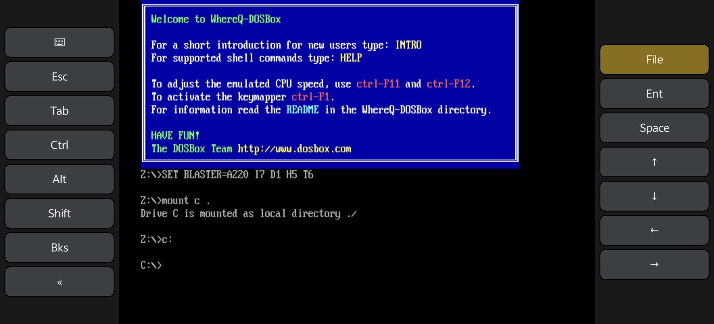

<p align="center">
  <picture>
    <source media="(prefers-color-scheme: dark)" srcset="resources/whereq-dosbox-logo-transparent.png">
    
  </picture>
</p>

<h1 align="center">WhereQ-DOSBox</h1>

<p align="center">
  A native <b>Android</b> port of DOSBox — the emulator core runs as
  <code>libdosbox.so</code> inside an APK, not in a browser.
</p>

<p align="center">
  
</p>

<p align="center">
  <sub>The DOSBox welcome screen, a mounted drive and the on-screen keyboard —
  touch moves the DOS mouse, the keys type into DOSBox.</sub>
</p>

---

The upstream project this is based on is [Em-DOSBox][em-dosbox], the
Emscripten/web build of DOSBox r4305 by [Boris Gjenero][dreamlayers]. The
DOSBox core here comes from that tree and keeps its GPLv2 license, its
`AUTHORS`, its `ChangeLog` and its per-file headers.

The port touches the core in four places, all of them small and local:

| Where | What |
|---|---|
| `src/gui/sdlmain.cpp` | the Android display, touch and on-screen keyboard paths, fenced behind `#if defined(__ANDROID__)` |
| `include/mouse.h`, `src/ints/mouse.cpp` | the touch-to-DOS-mouse mapping, likewise fenced |
| the product name | `DOSBox SVN` → `WhereQ-DOSBox` in the banner, the version string, the config and the generated headers |
| `src/hardware/dbopl.cpp` | the two percussion modes are named in a switch, so clang stops warning about it — the behavior is unchanged |

Everything else in `src/` and `include/` is the imported upstream code.

Status
------

Verified on an emulator (API 37, x86_64): DOSBox reaches the `C:\>` prompt,
the picture is rendered through the SDL2 texture path with aspect-correct
letterboxing, touch moves the DOS mouse to the computed cell, and the
on-screen keyboard types into DOSBox with no upstream patch
(`SDL_PushEvent` → mapper → `KEYBOARD_AddKey`).

| | |
|---|---|
| Emulator core | DOSBox r4305 (SDL2 branch) |
| Android target | `arm64-v8a`, `armeabi-v7a`, `x86_64`, minSdk 21 |
| Toolchain | NDK r27 + CMake; also builds a plain desktop Linux baseline |
| Version scheme | `v{major}.{minor}.{patch}.{build}` — see `bin/release.sh` |
| APK size | ~5.3 MB with all three ABIs |

Layout
------

```
src/ include/ ...     the DOSBox core, as imported (GPLv2)
android/              CMake/NDK project -> libdosbox.so, plus the APK
native/               desktop Linux baseline build (VPATH, out of tree)
bench/                CPU-core throughput probe
toolchain/            rootless dev toolchain (no root, no sudo)
third_party/          SDL2 sources, fetched by third_party/fetch-sdl2.sh
resources/            the logo and the screenshot
porting/              the porting log, benchmark notes and screenshots
bin/                  build.sh (every build scenario), release.sh
```

Build
-----

Everything is driven by one script:

```sh
git clone git@github.com:whereq/whereq-dosbox.git
cd whereq-dosbox

bin/build.sh doctor      # what is installed, what is already built
bin/build.sh all         # bootstrap + native + android + apk
```

That produces:

```
build/install/bin/dosbox                  the desktop baseline
build/android/<abi>/libdosbox.so          the native library per ABI
build/apk/whereq-dosbox-debug.apk         the debug APK
```

The individual steps are `bin/build.sh bootstrap | native | android | apk`,
and each one delegates to the script that owns it
(`third_party/fetch-sdl2.sh`, `toolchain/bootstrap-sysroot.sh`,
`native/build-native.sh`, `android/build-android.sh`, `android/build-apk.sh`).

`android/build-apk.sh` is the canonical APK build — it needs no Gradle
installation and no dependency download. The Gradle project in
`android/app/` produces an equivalent APK.

**[BUILDING.md](BUILDING.md) has the full guide**: every build scenario with
a command you can paste — the first build on a fresh clone, the release APK
with its signing variables, the Gradle path, the launcher icons, the version
bump and the benchmark.

`porting/ANDROID-PORT.md` is the running log of the port: what was verified,
what was corrected, and what is still open. `porting/BENCH-NOTES.md` has the
throughput measurements.

Release
-------

The version lives in the git tag. `bin/release.sh` bumps it, mirrors it into
the `VERSION` file, commits, tags and pushes:

```sh
bin/release.sh -m "Fix the Android audio latency"
bin/release.sh --patch -m "..."
```

Tags are `v{major}.{minor}.{patch}.{build}` — four numeric segments. The
`android:versionCode` is the same four segments packed into a monotonically
increasing integer.

The production APK is signed with the release key, which is never committed:

```sh
export WHEREQ_RELEASE_STORE_PASS='<keystore password>'
bin/build.sh apk --release
```

See [BUILDING.md](BUILDING.md#scenario-5--the-release-apk) for the signing
variables and the verification commands.

License
-------

**GNU General Public License, version 2.** See [COPYING](COPYING) for the
full text and [NOTICE](NOTICE) for the attribution.

This is not a choice: the tree embeds the DOSBox core, which is GPLv2, and
GPLv2 requires that derivative works be distributed under the same license.
The porting work on top of it (`android/`, `native/`, `bench/`, `toolchain/`,
`bin/`) is covered by the same license.

The DOSBox core is © the DOSBox Team and its contributors, and is imported
here with its `AUTHORS`, `ChangeLog`, `COPYING` and per-file headers intact,
as GPLv2 requires. The upstream project is [Em-DOSBox][em-dosbox]; the DOSBox
project itself is at [dosbox.com][dosbox].

"DOSBox" is a trademark of the DOSBox project. This port is not affiliated
with or endorsed by the DOSBox team.

Credits
-------

Most of the credit belongs to the
[DOSBox crew](https://www.dosbox.com/crew.php).
They created DOSBox and made it compatible with a wide variety of DOS games.
[Ismail Khatib](https://github.com/CeRiAl) got DOSBox
to compile with Emscripten, but didn't get it to work.
[Boris Gjenero](https://github.com/dreamlayers)
started with that and got it to work. Then, Boris re-implemented
Ismail's changes a cleaner way, fixed issues and improved performance to make
many games usable in web browsers. Meanwhile,
[Alon Zakai](https://github.com/kripken/) quickly fixed Emscripten bugs which
were encountered and added helpful Emscripten features.

[em-dosbox]: https://github.com/dreamlayers/em-dosbox
[dreamlayers]: https://github.com/dreamlayers
[dosbox]: https://www.dosbox.com/

---

## Upstream project

The text below is the README of the upstream Em-DOSBox project, kept exactly
as it was imported.

DOSBox ported to Emscripten
===========================

About
-----

[DOSBox](https://www.dosbox.com/) is an open source
[DOS](https://en.wikipedia.org/wiki/DOS) emulator designed for
running games. [Emscripten](https://emscripten.org/) compiles code to
JavaScript and [WebAssembly](https://webassembly.org/). This is a version of
DOSBox which can be compiled with Emscripten to run in a web browser. It allows
running old DOS games and other DOS programs in a web browser.

DOSBox is distributed under the GNU General Public License. See the
[COPYING file](COPYING) for more information.

Status
------

Em-DOSBox runs most games successfully in web browsers. Although DOSBox has
not been fully re-structured for running as an Emscripten main loop, most
functionality is available thanks to Emscripten Asyncify. A few programs can
still run into problems due to paging exceptions.

Other issues
------------

* Game save files are written into the Emscripten file system, which is by
  default an in-memory file system. Saved games will be lost when you close
  the web page. It is possible to interface other JavaScript code with the
  Emscripten file system to address this issue.
* Compiling in Windows is not supported. The build process requires a
  Unix-like environment due to use of GNU Autotools. See Emscripten
  [issue 2208](https://github.com/kripken/emscripten/issues/2208).
* Emscripten [issue 1909](https://github.com/kripken/emscripten/issues/1909)
used to make large switch statements highly inefficient. It seems fixed now,
but V8 JavaScript Engine [issue
2275](https://bugs.chromium.org/p/v8/issues/detail?id=2275) prevents large switch
statements from being optimized. Because of this, the simple, normal and
prefetch cores are automatically transformed. Case
statements for x86 instructions become functions, and an array of function
pointers is used instead of the switch statements. The `--enable-funarray`
configure option controls this and defaults to yes.
* Most web browsers prevent access to other files when using `file://` URLs.
Use a web server such as `python -m http.server` instead.
* In Firefox, ensure that
[dom.max\_script\_run\_time](https://kb.mozillazine.org/Dom.max_script_run_time)
 is set to a reasonable value that will allow you to regain control in case of
a hang.
* Firefox may use huge amounts of memory when starting asm.js builds which have
not been minified.
* The FPU code uses doubles and does not provide full 80 bit precision.
DOSBox can only give full precision when running on an x86 CPU.

Compiling
---------

This code retains the ability to build a normal version of DOSBox, for
running as an ordinary computer application. These instructions are focused
on how to build using Emscripten, for running in a web browser.

Use the latest stable version of Emscripten. For
more information see the the
[Emscripten installation instructions](https://emscripten.org/docs/getting_started/downloads.html).
Em-DOSBox depends on bug fixes and new features found in recent versions of
Emscripten. Some Linux distributions have packages with old versions, which
should not be used.

First, create `./configure` by running `./autogen.sh`. Then
configure with `emconfigure ./configure` and build with `make`.
DOSBox will be contained in `src/dosbox.js`, and if WebAssembly is enabled
(the default), `src/dosbox.wasm`.  Also, `src/dosbox.html` will be created,
which is a simple web page that provides an interface to DOSBox. You can
customize it or use DOSBox in your own web page. If you built with Asyncify
enabled (the default), you can open `src/dosbox.html` via a web server, and
run DOSBox. Without Asyncify DOSBox won't work like that, and you need to add
files to run. See below for information on "Running DOS Programs".

This branch supports SDL 2 and uses it by default. Emscripten will
automatically fetch SDL 2 from Emscripten Ports and build it. Use of `make -j`
to speed up compilation by running multiple Emscripten processes in parallel
[may break this](https://github.com/kripken/emscripten/issues/3033).
Once SDL 2 has been built by Emscripten, you can use `make -j`.
To use a different pre-built copy of Emscripten SDL 2, specify a path as in
`emconfigure ./configure --with-sdl2=/path/to/SDL-emscripten`.

To use SDL 1, give a `--with-sdl2=no` or `--without-sdl2` argument to
`./configure`. There will be more problems, like some keys not working and the
mapper not displaying. Emscripten's SDL 2 is better.

Emscripten [Asyncify](https://emscripten.org/docs/porting/asyncify.html) is
used by default. This enables more DOSBox features to work, and only causes
a very small performance penalty.

If building with Emscripten versions between 1.29.4 and 1.39.17, you could
try using Emterpreter Sync instead of Asyncify. This is depreciated, worse
than Asyncify and not recommended. Such builds create a memory initialization
file `src/dosbox.html.mem` needs to be in the same folder as `dosbox.js`. The
memory initialization file is large. Serve it in compressed format to save
bandwidth.

Running DOS Programs
--------------------

When compiled using Asyncify, you can interactively load files. In DOSBox,
first use `mount c: /` and `c:` commands to provide a space for new files.
Then use the `wget` command to retrieve files from the same web server.
You can use relative URLs, simply providing file names to load files from
the same directory as the HTML page.

If not using Asyncify, or generally, for convenience, you can create web pages
which run particular games. Such a page needs to load files into the Emscripten
file system and give command line arguments to DOSBox. The simplest method is
by using the included packager tools.

The normal packager tool is `src/packager.py`, which runs the Emscripten
packager. It requires `dosbox.html`, which is created when building Em-DOSBox.
If you do not have Emscripten installed, you need to use `src/repackager.py`
instead. Any packager or repackager HTML output file can be used as a template
for the repackager. Name it `template.html` and put it in the same directory
as `repackager.py`.

The following instructions assume use of the normal packager. If using
repackager, replace `packager.py` with `repackager.py`. You need
[Python 3](https://www.python.org/downloads/) to run either packager.

If you have a single DOS executable such as `Gwbasic.exe`, place
it in the same `src` directory as `packager.py` and package it using:

```./packager.py gwbasic Gwbasic.exe```

This creates `gwbasic.html` and `gwbasic.data`. Placing those in the same
directory as `dosbox.js` and viewing `gwbasic.html` will run the program in a
web browser:

Most browsers prevent access to the required
data files while using `file://` URLs. To get around this you can use Python's
built in HTTP server and point the browser to
[http://localhost:8000](http://localhost:8000).

```python -m http.server 8000```

If you need to package a collection of DOS files. Place all the files in a
single directory and package that directory with the executable specified. For
example, if Major Stryker's files are in the subdirectory `src/major_stryker`
and it's launched using `STRYKER.EXE` you would package it using:

```./packager.py stryker major_stryker STRYKER.EXE```

Again, place the created `stryker.html` and `stryker.data` files in the same
directory as `dosbox.js` and view `stryker.html` to run the game in browser.

You can also include a [DOSBox
configuration](https://www.dosbox.com/wiki/Dosbox.conf) file that will be
acknowledged by the emulator to modify any speed, audio or graphic settings.
Simply include a `dosbox.conf` text file in the package directory before you
run `./packager.py`.

To attempt to run Major Stryker in CGA graphics mode, you would create the
configuration file `src/major_stryker/dosbox.conf` and include this body of
text:

```
[dosbox]
machine=cga
```

Then package it using:

```./packager.py stryker-cga major_stryker STRYKER.EXE```

Credits
-------

Most of the credit belongs to the
[DOSBox crew](https://www.dosbox.com/crew.php).
They created DOSBox and made it compatible with a wide variety of DOS games.
[Ismail Khatib](https://github.com/CeRiAl) got DOSBox
to compile with Emscripten, but didn't get it to work.
[Boris Gjenero](https://github.com/dreamlayers)
started with that and got it to work. Then, Boris re-implemented
Ismail's changes a cleaner way, fixed issues and improved performance to make
many games usable in web browsers. Meanwhile,
[Alon Zakai](https://github.com/kripken/) quickly fixed Emscripten bugs which
were encountered and added helpful Emscripten features.
