# WhereQ-DOSBox — user guide

> **For everyone.** You do not need to know anything about DOS. You need a
> phone, one game, and about five minutes.

## What this is

WhereQ-DOSBox is DOSBox on Android. DOSBox is the program that runs old
DOS games — the ones from 1994, the ones that came on a floppy disk and ran at
320×200 — on a machine that never existed.

This app puts that program on your phone. You put a game in, press **Play**,
and the game runs, with the sound, with the save states, with a keyboard you
can actually touch.

Everything happens on your phone. There is no account, no sign-in, no
tracking, and no network traffic — once the game is on the phone, the game
plays with the phone in aeroplane mode.

---

## The five-minute version

1. Install the app (the APK is on the [releases page](https://github.com/whereq/whereq-dosbox/releases)).
2. Open it. You land on the **Files** panel, which is empty.
3. Press **+ Install a bundle (.zip)** and pick a `.zip` game file.
4. Press **Play**. The game starts.
5. Press **File** (top left) whenever you want to come back to the list.

Everything else in this guide is the detail behind those five steps.

---

## Before you start

| | |
|---|---|
| Phone | Android 6.0 or newer, any phone or tablet |
| Space | about 60 MB for the app, plus the size of the game |
| Network | none needed once the app and the game are on the phone |
| Account | none |

You also need **a game**, as a single `.zip` file. A game for this app is not
the same thing as a ZIP of your own files; see
[Where do I get a game?](#where-do-i-get-a-game) below.

---

## Step 1 — Install the app

The app is not in this repository. It is built by the release pipeline and
published on the [releases page](https://github.com/whereq/whereq-dosbox/releases)
as `whereq-dosbox-<version>.apk`, with a `.sha256` file next to it carrying the
checksum.

Copy the `.apk` to your phone — cable, cloud drive, a file-sharing app,
whatever is at hand — then tap it on the phone. Android asks whether to allow
installing from that app; allow it, and the install goes through.

The app appears on your home screen as the **`>_` mark**:

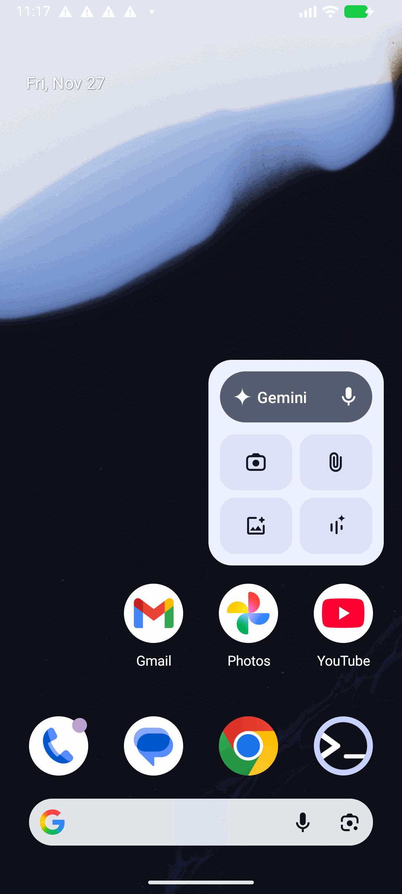

The name in the app list, the notification, and the screen Android shows for
the app all read **WhereQ-DOSBox**:

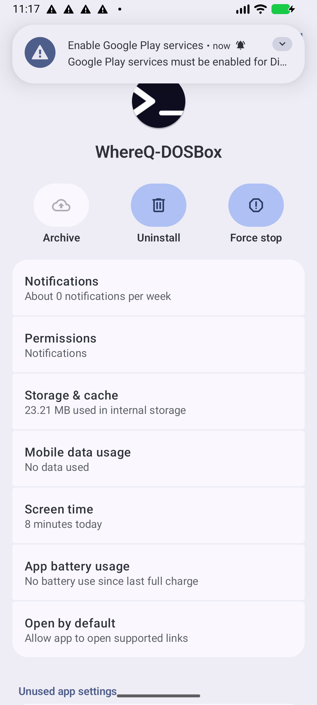

---

## Step 2 — Install a game

Open the app. You land in the **Files** panel — the screen that lists what
you have installed:

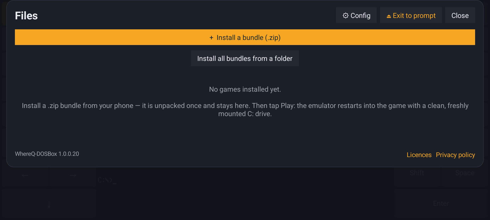

Two ways to get a game in, both at the top of the panel:

| button | what it does |
|---|---|
| **+ Install a bundle (.zip)** | pick one `.zip` from your phone |
| **Install all bundles from a folder** | unpack every `.zip` in one folder at once |

Press **+ Install a bundle (.zip)**, and the system's file picker opens on
**Downloads**. Pick your game's `.zip` and press **USE THIS FOLDER**:

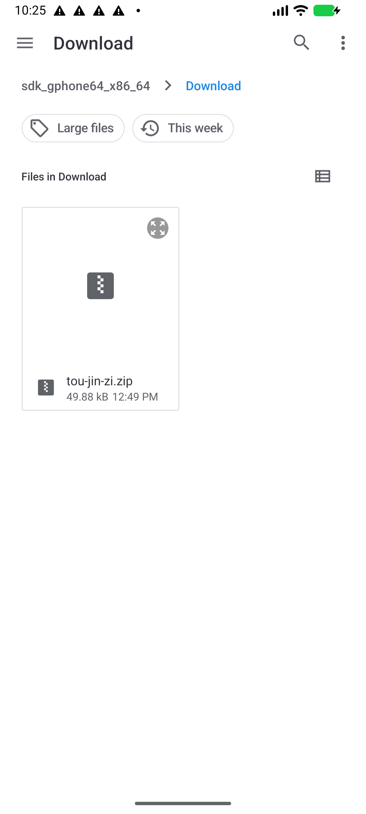

The app unpacks it and registers it. The panel then lists it:

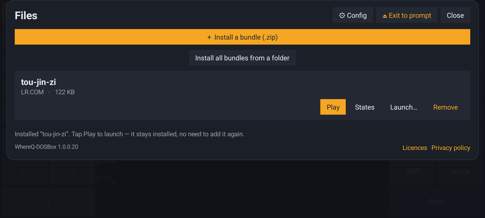

Each game in the list has four buttons:

| button | what it does |
|---|---|
| **Play** | start the game from the beginning |
| **States** | save and load save states for this game |
| **Launch…** | run a different program, or add driver files, before the game |
| **Remove** | uninstall this game from the app |

### Where do I get a game?

A game for this app is a `.zip` with a small, fixed shape:


<details>
<summary>The same diagram as text (the SVG above is the aligned version)</summary>

```
  the bundle
  ─────────
  PLAY.BAT          the entry point - the app runs this
  <the game files>  whatever the game needs
  __meta.json       the name the app shows in the list
```

</details>

That is it. The repository ships one, so you can see the shape and try the app
immediately: [`examples/game-bundle`](https://github.com/whereq/whereq-dosbox/tree/main/examples/game-bundle)
— the **STARFALL** demo. Copy `whereq-demo-bundle.zip` from that folder to
your phone and install it.

For real games: sites that still host abandonware DOS games generally offer
them as a `.zip`. If a game's archive contains the game files but no
`PLAY.BAT`, the app cannot start it — make a `PLAY.BAT` that runs the game's
executable, and zip the folder again.

---

## Step 3 — Play the game

Press **Play**.

The emulator restarts the app and boots the game, and you land at a DOS
prompt:

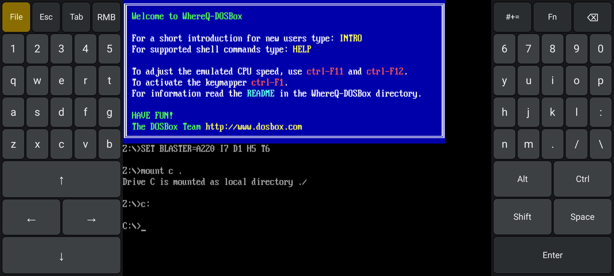

Type the game's name and press **Enter**. From then on it is the real game —
the real keyboard, the real sound, the real mouse.

Here is a real 1994 DOS game running on a phone — 偷金子, the DOS Lode Runner:

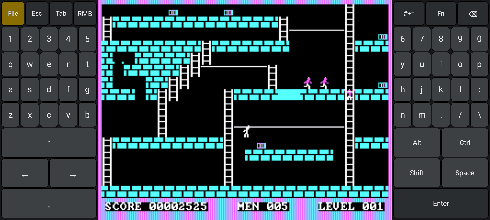

And here are two more. Formula 1 (Domark, 1994):


And here is the STARFALL demo:


The first time a game runs, Android may ask whether the app may send you
notifications. It uses them for a "back to the game" reminder when you leave
the app. Answer either way — declining only means you lose that reminder:

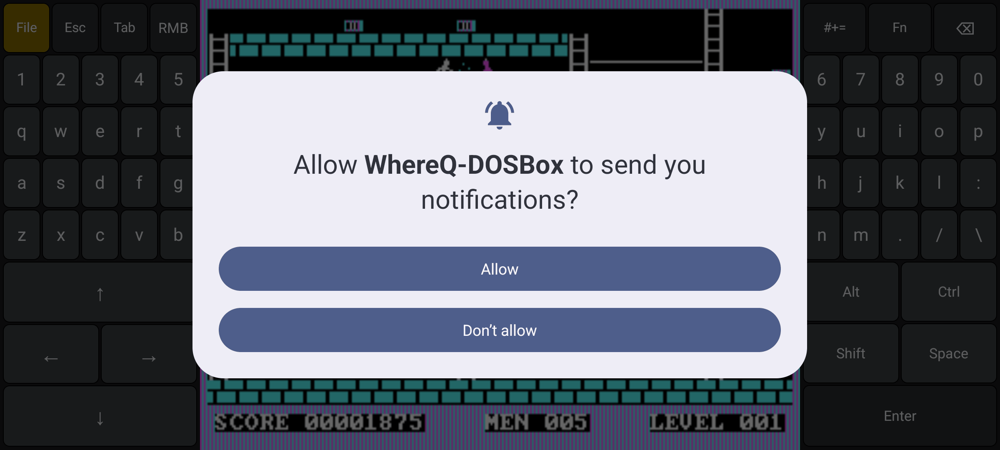

When a game is running, the **File** key (top left) brings the Files panel
back over it, and the panel shows a **Resume** line for the game that is
running right now:

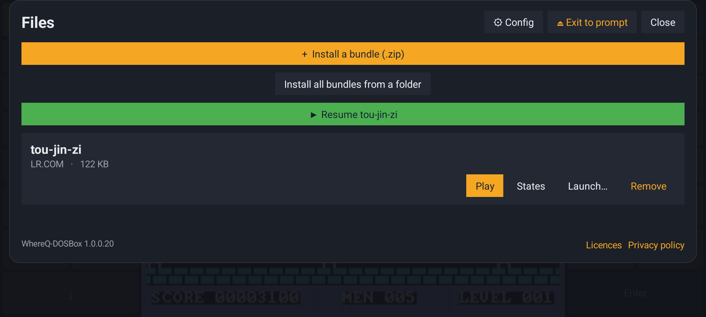

### The game keeps running in the background

WhereQ-DOSBox holds a foreground service while a game is running, so the
emulator stays resident when you leave the app. The shade carries an ongoing
notification:

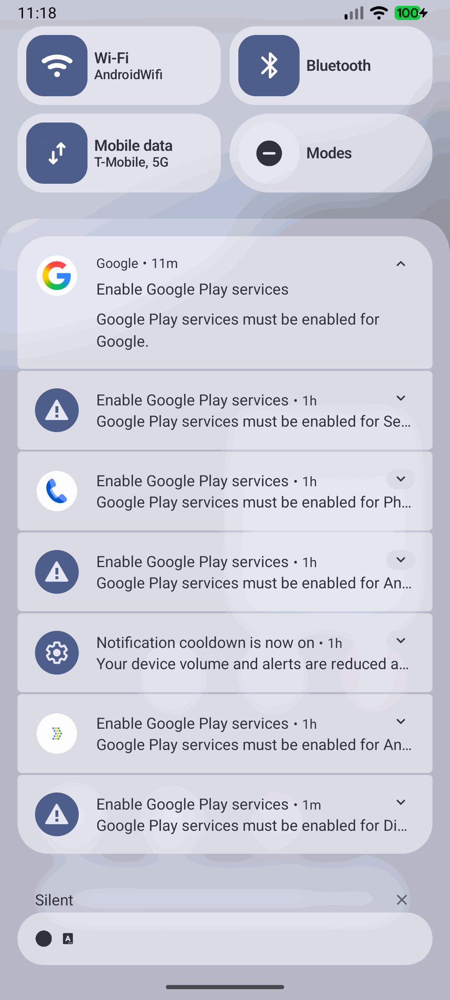

Tap it and you are back in the game, with the emulator still running — nothing
was lost while you were away:

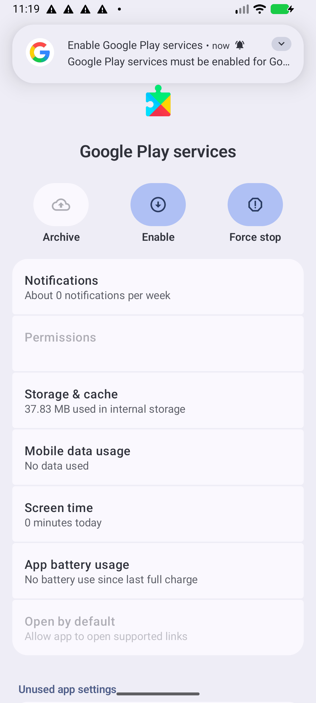

---

## Step 4 — The keyboard and the mouse

There is no physical keyboard in the way, because the screen keyboard *is*
the keyboard. In landscape you get two pads beside the picture, the way a
handheld console is built: the **left pad** has the arrow keys as a D-pad and
the left half of a split QWERTY, the **right pad** has the action keys
(Alt, Ctrl, Shift, Space, Enter) and the right half of the alphabet.

Two keys change what the pads show:

| key | shows |
|---|---|
| **#+=** | the punctuation layer |
| **Fn** | F1–F12, Ins/Del, Home/End, PgUp/PgDn, Caps, PrtSc, Pause |

The switched key lights up while its layer is on.

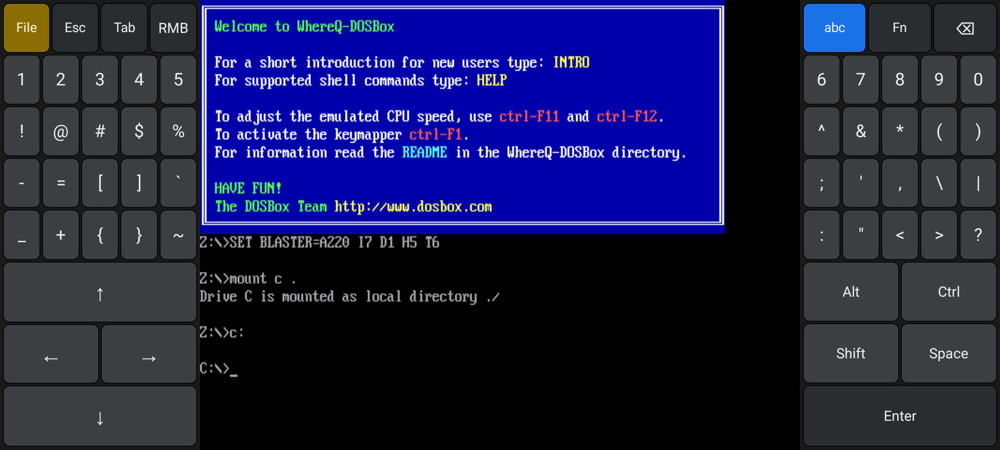

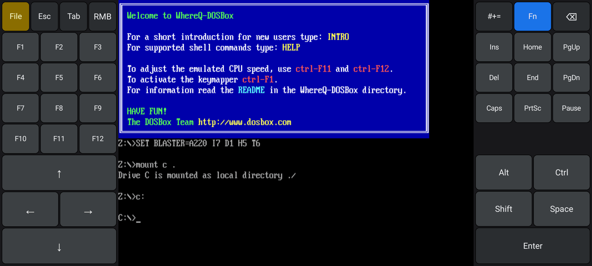

**Modifiers work two ways.** *Tap* Ctrl, Alt or Shift and it stays armed for
the next key — Ctrl, then C. *Hold* it and it behaves like a real key for as
long as your finger is down, which is what a game expects of its fire and
strafe keys while the other thumb steers.

**Double-tap Shift for Caps Lock.** Two quick taps on Shift turn Caps Lock on;
the key reads **CAPS** and stays lit. Double-tap again to turn it off. (A slower
second tap just cancels an armed Shift, as before.)

**The mouse is the screen.** Your finger is the mouse: drag to move the
pointer, tap to click, and the on-screen **RMB** key (on the left pad, next
to **Tab**) is the right mouse button — in most DOS games that is *cancel* or
*back*. A **second finger** on the picture does the same, at that finger's
own position.

Turn the phone to portrait and the pads fold into a single strip along the
bottom, for the games that are taller than they are wide.

**The layout follows the screen.** The letterbox bar beside the 4:3 DOS picture
has to be at least 116 dp wide to carry a full pad. On a narrow landscape
phone it still does — an 18:9 bar is 137 dp — but the letter keys are squeezed
to about 24 dp, against 33 dp on a 20:9 screen. The D-pad and the action keys
keep their full size; it is the letters that get tight. The **#+=** and **Fn**
layers are tight in the same way.

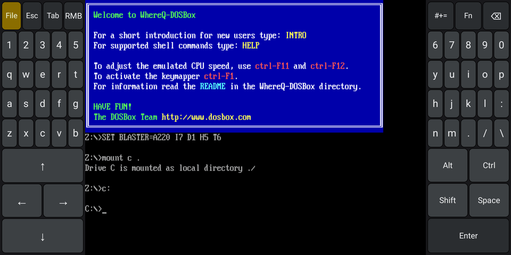

**Below 116 dp the pads give way to columns.** There is no longer room for a
half-keyboard beside the picture, so the pads become a single column of keys per
side — arrows on the left, the action keys on the right — and the whole QWERTY
folds up from the bottom when you want it.


The **⌨** key in the left column opens the QWERTY, which rises from the
bottom over the picture and closes again with the same key.


Below 56 dp even that is too much, and the keyboard becomes a slim strip along
the bottom of the screen.

---

## Game Mode — a gamepad for action games

Some games want a gamepad, not a typewriter. **Game Mode** replaces the keyboard
pads with a console-style controller: a direction pad and a trackball, with the
buttons a DOS game actually fires, jumps and strafes with.

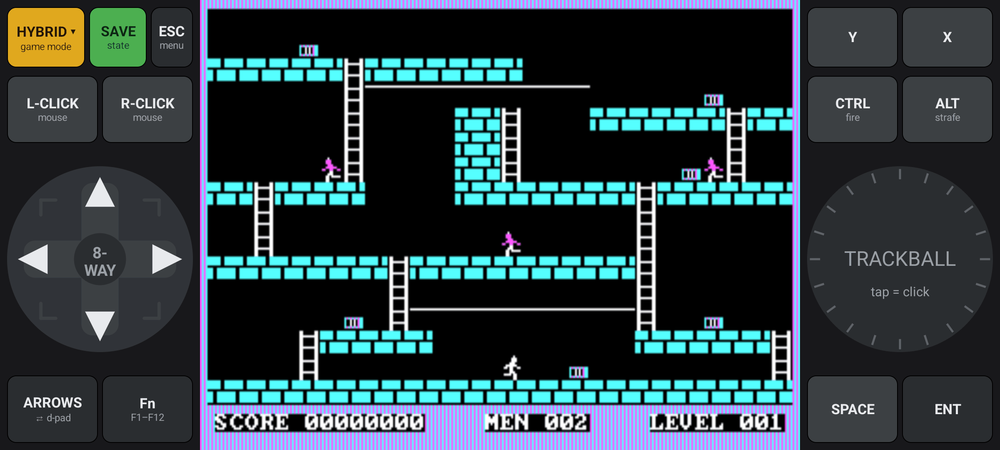

**Getting in and out is a nod to the old days.** With the keyboard pads showing,
switch **Caps Lock** on first — double-tap **Shift**, and the key turns blue and
reads *CAPS* — then enter the **Konami code** on the pads —
**↑ ↑ ↓ ↓ ← → ← → B A** — and the pads flip into Game Mode. The **B** and **A**
must be *capital*: the code watches the letters in the case you actually type
them, so a lowercase "ba" just types "ba" into the DOS prompt. To go back,
enter it again on the gamepad: the **↑ ↑ ↓ ↓ ← → ← →**
on the D-pad, then **X, Y** (the two face buttons stand in for B and A). The
phone's **Back** button also returns you to the keyboard.

The gold button at the top-left names the current **profile**; tap it to cycle,
long-press for a picker. Each game remembers the profile and D-pad you last used
with it.

**The green SAVE button next to it saves the game without leaving the
gamepad.** Tap it and the running machine is frozen into a slot straight away
— the first free one, or, when all five are full, the oldest, so the four
newest saves are the ones that survive. Hold it and the **Save states** sheet
opens over the gamepad, so a slot can be picked by hand; Game Mode is still
there when the sheet closes.

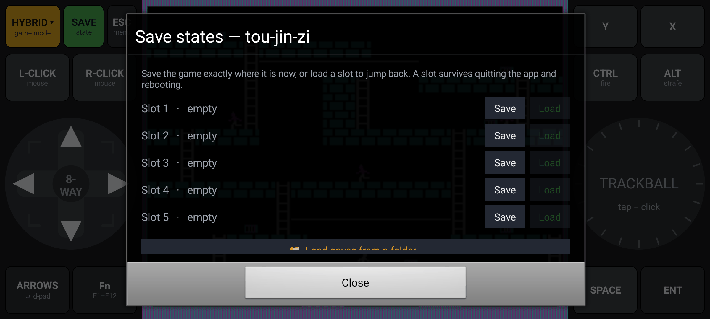

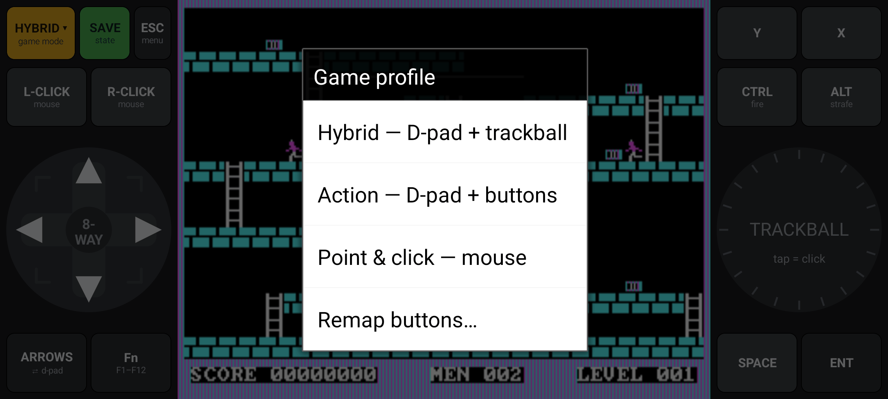

| profile | left thumb | right thumb | for |
|---|---|---|---|
| **Hybrid** (default) | 8-way D-pad | trackball | games that mix keys and mouse — Dune II, X-COM, Doom with a mouse |
| **Action** | 8-way D-pad | FIRE / JUMP / USE / ENT buttons | keyboard arcade/shooters — Wolf3D, Keen, Prince of Persia |
| **Point** | big LEFT / RIGHT mouse buttons | trackball | mouse-only games — Monkey Island, Civilization, Lemmings |

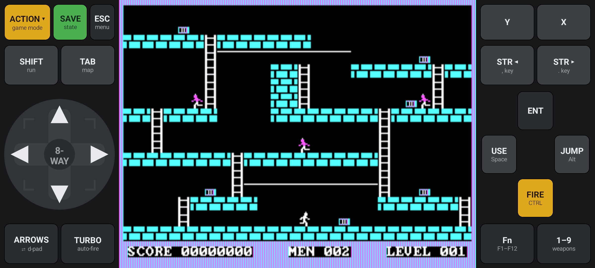

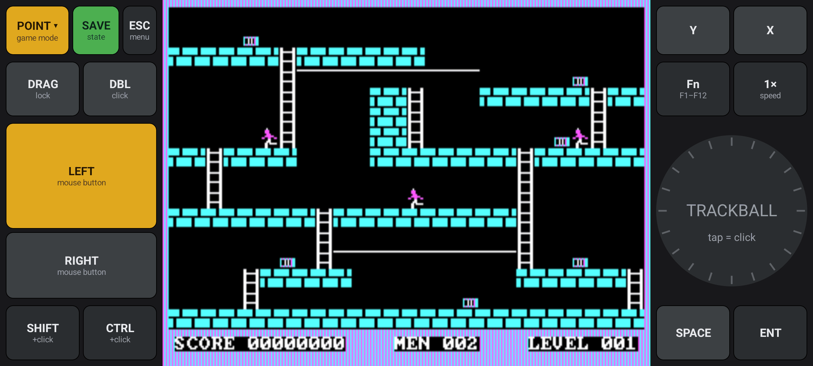

**The exit code needs a D-pad.** The reverse Konami code is typed on the
gamepad's **D-pad**, and **Point & click** does not have one — its left thumb
gets the mouse buttons instead. Switch back to **Hybrid** (or **Action**) and
the code works. With the pads back, the same ↑ ↑ ↓ ↓ ← → ← → and then **X, Y**
returns you to the keyboard, and the game carries on underneath:

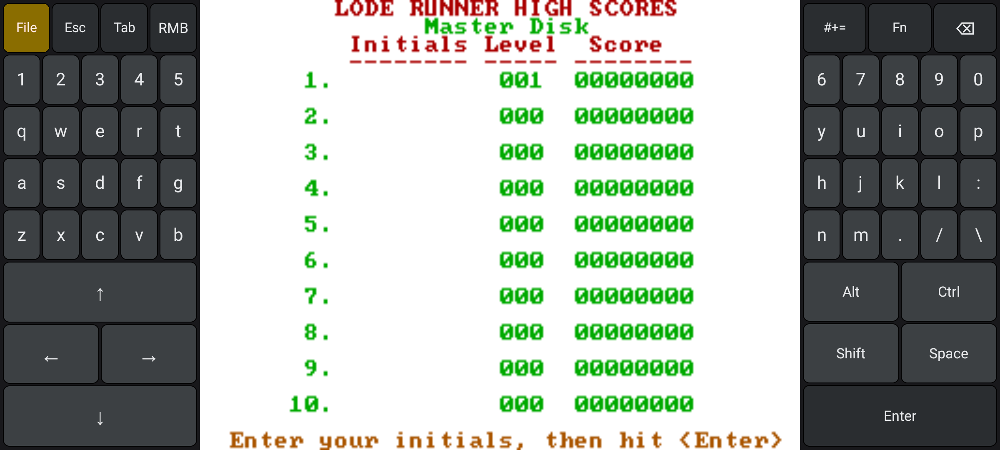

The **trackball** moves the pointer the way a laptop touchpad does — stroke to
move, **tap to click** — rather than jumping it to where you touch. In Hybrid,
holding **L-CLICK** (left shoulder) while you roll the trackball is a drag-select.

### The D-pad output — ARROWS, NUMPAD, WASD

DOS games don't agree on which keys "up" is. The **ARROWS** button under the
D-pad cycles what the pad sends, and the app remembers your choice per game:

| mode | up / down / left / right | a diagonal (e.g. up-right) | choose it for |
|---|---|---|---|
| **ARROWS** | the arrow keys ↑ ↓ ← → | **two keys at once** (↑ + →) | most games — anything that reads the cursor keys |
| **NUMPAD** | the numeric keypad 8 / 2 / 4 / 6 | a **single** key — 7 / 9 / 1 / 3 | games built for the numpad, where a diagonal is its own key (many roguelikes and joystick-via-keypad games) |
| **WASD** | the letters W / A / S / D | **two keys at once** (W + D) | later shooters and anything mapped to WASD |

So the difference is both *which* keys the pad presses and *how a diagonal is
sent*: ARROWS and WASD press the two neighbouring keys together, while NUMPAD has
a real key for each of the eight directions. If your game ignores the D-pad, it is
almost always the wrong mode — switch with the ARROWS button until it responds.

### Remapping a button

Sometimes a game wants a key the pad does not have — **F** to fire, **SPACE** to
jump, the **numeric keypad** to shoot. You can teach any Game Mode button to
send a different key, and the app remembers it for that game.

**Long-press the gold profile button** (top-left, the one that names the
profile) and choose **Remap buttons…**. The screen enters *remap mode*: a banner
along the top says *"Tap a button to remap"*, and the buttons you can change are
outlined in gold. **Tap one** and a list of keys opens — pick the one you want.
**DONE** (or the banner) leaves remap mode.

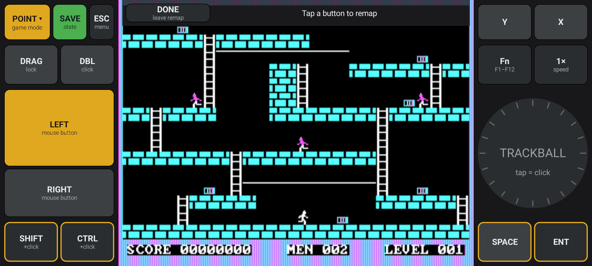

| you can change | you cannot change |
|---|---|
| **CTRL, ALT, SHIFT, TAB, STR ◂, STR ▸, SPACE, ENT, USE, JUMP** and **FIRE** | the **X** and **Y** buttons (they answer the game's *Quit? (Y/N)* prompts and the Konami code), **ESC**, the D-pad, the trackball, the mouse buttons, and the function chips (**ARROWS**, **Fn**, **1–9**, **TURBO**, **SPEED**, **DRAG**, **DBL**) |

A changed button shows the new key instead of its old name — **FIRE** keeps its
name and shows the key under it. **Reset to default**, the first entry in the
list, puts the button back.

Remaps are per game and cover every profile, so a game remembers what each
button sends whichever profile you play it in.

---

## Step 5 — Save a state

A **save state** is the whole machine frozen: the CPU, the memory, the video
memory, the sound chips, the open DOS file handles. Load it and the game is
exactly where you left it — even if the app was closed in between.

Press **File**, then **States** next to the game:

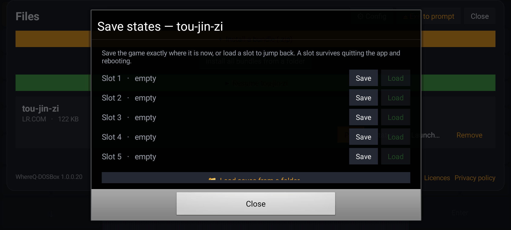

There are five slots. Press **Save** to freeze the game into slot 1, and the
sheet shows when you did it:

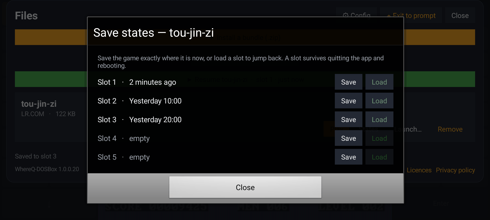

Close the sheet and the Files panel carries a **Resume** line for the game,
naming the slot and the moment it was made:

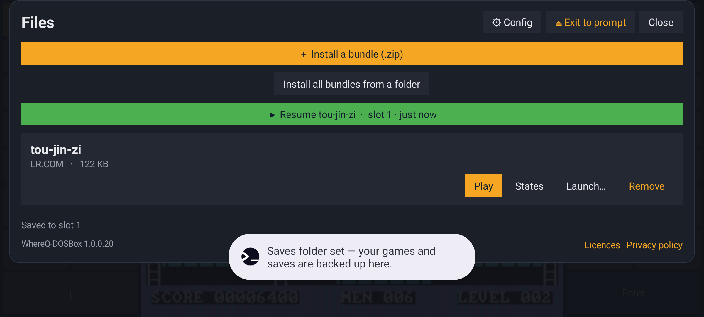

**Load** puts the game back. A slot survives quitting the app and rebooting
the phone.

The time on a slot is exact once it stops being "today": a save from
yesterday reads *Yesterday 21:40*, and an older one reads *Nov 25 09:12*. Two
saves from the same day can therefore be told apart, and put in order — which
is what the second and third slots above show: both made yesterday, an hour
and ten hours earlier, and the newer one obvious.

---

## Step 6 — Keep your saves safe

A save state normally lives inside the app's own private storage. Android
deletes that when you uninstall the app — and when you lose the phone, or
switch phones. Your games and your saves go with it.

So the app asks, once, whether you want a second copy somewhere that is
yours:

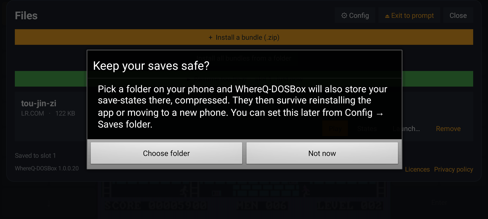

The app says the same thing in its own dialog, which you can open at any time:

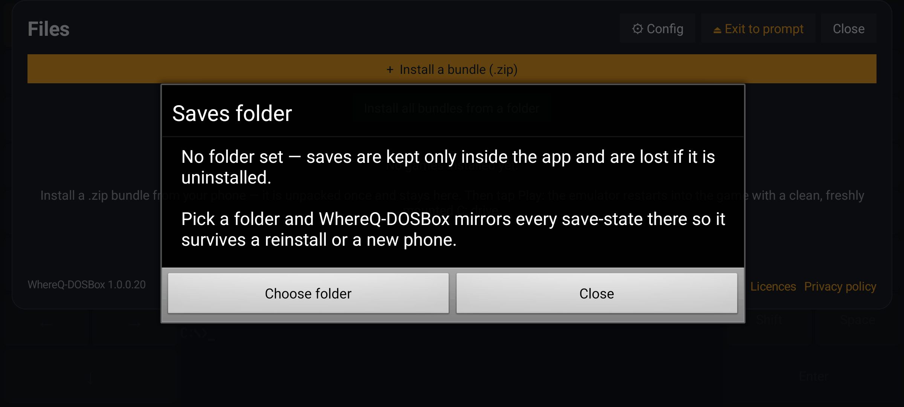

Press **Choose folder**, and the system asks you to allow the app into a
folder on your phone:

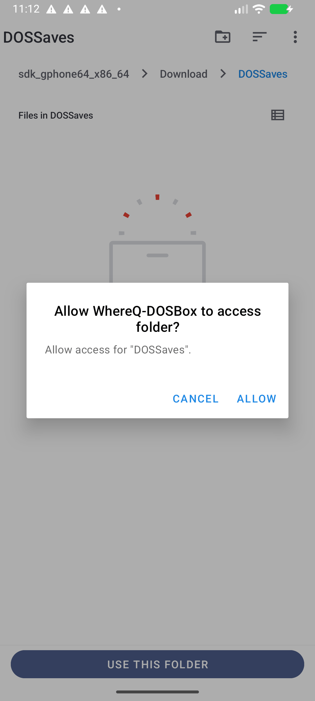

Pick a folder, press **USE THIS FOLDER**, and press **ALLOW**. From then on
every slot is mirrored into that folder, compressed, next to the game itself.

You can see, and change, the folder at any time under **Config → Saves
folder**:

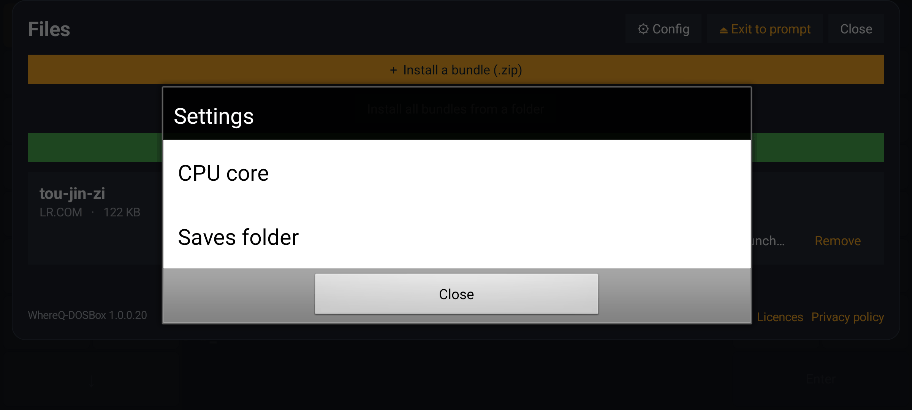

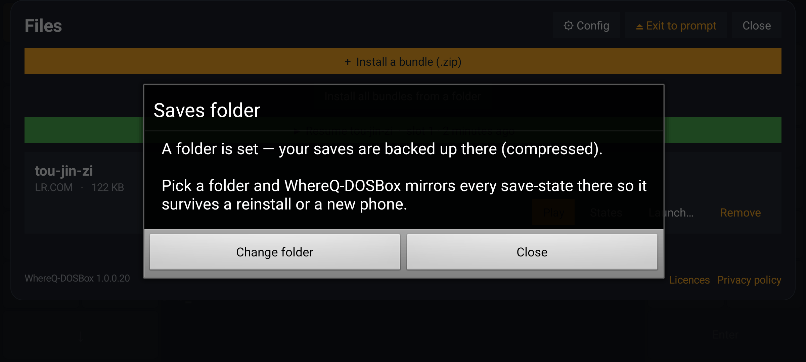

Two notes:

- Android refuses to let an app take the **Download** folder itself, because
  that would be too broad a permission. Pick any other folder — **Documents**
  is fine.
- You only have to answer this once. The app does not ask again.

---

## Step 7 — After a reinstall, or on a new phone

This is what the folder is for.

Uninstall the app, install it again, and choose the same folder. The app
looks inside it and finds your games — they are still there, because they
were never inside the app:

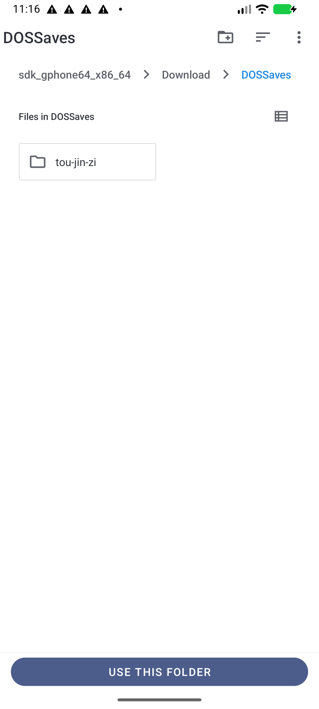

The app notices the games that are not installed and offers to bring them
back:

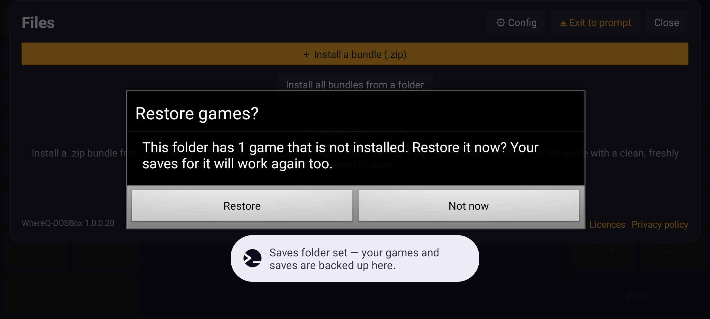

Press **Restore**, and it comes back with its name and its save:

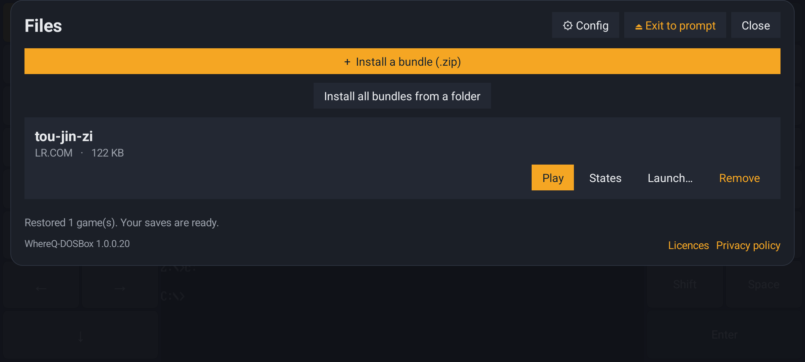

And the save state still knows when it was made:

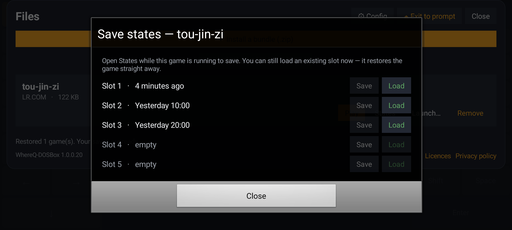

That last line is the point of the whole feature. A save that was made four
minutes ago says *4 minutes ago*, and one made yesterday still says *Yesterday
10:00* — even after it was rebuilt from the folder on a fresh install.

---

## Where everything lives


<details>
<summary>The same diagram as text (the SVG above is the aligned version)</summary>

```
  inside the app                    the folder you picked
  ────────────                      ───────────────────
  the games                         <your folder>/
  the save-state slots                <game name>/
                                       slot1.gz
                                       slot2.gz
                                       bundle.zip

  gone when the app is removed     stays until you delete it
```

</details>

---

## If something goes wrong

| what you see | what it means | what to do |
|---|---|---|
| *"That save file is damaged"* | the slot was written by an older version | the save format grew a version; older slots are refused rather than misread. Start a new slot. |
| The game does not start | the bundle has no `PLAY.BAT`, or the entry point is wrong | open the `.zip` and check that `PLAY.BAT` runs the game's executable |
| Nothing happens when you tap **Play** | the emulator is restarting to boot the game | wait a few seconds — the process restarts on purpose, and the game starts in the new process |
| The keyboard is in the way | the pads take the sides of the screen | turn the phone to portrait for a single strip along the bottom |
| The mouse does not click | the game wants the mouse *held* | drag for movement; the on-screen **RMB** key, or a second finger on the picture, is the right button |
| You cannot pick the **Download** folder | Android will not grant an app the whole Download folder | pick another folder, such as **Documents** |
| You get a notification prompt | the app wants to show the "back to the game" notification | allow it or decline it — you can decline, you just lose that notification |
| The game is slow | the emulator runs the original hardware, not a fast one | it is what the 1994 machine did. It is not the phone being slow. |

---

## Where to go next

- **[The technical reference](TECHNICAL-REFERENCE.md)** — how all of this
  actually works: the native build, the save-state machine, the exact sound
  snapshot, the bundle launcher, the keyboard, the build pipeline. It is a
  long document, written for engineers.
- **[The repository](https://github.com/whereq/whereq-dosbox)** — the source,
  the example bundle, the issues.
- **[The releases page](https://github.com/whereq/whereq-dosbox/releases)** —
  the APK, with its checksum.
- **[The announcements](https://whereq.github.io/news/)** — what shipped, and
  why.

The project is GPL-2.0, and the DOSBox core is embedded with its `AUTHORS`,
`ChangeLog`, `COPYING` and per-file headers intact. DOSBox is a trademark of
the DOSBox project; this port is not affiliated with or endorsed by the
DOSBox team.
